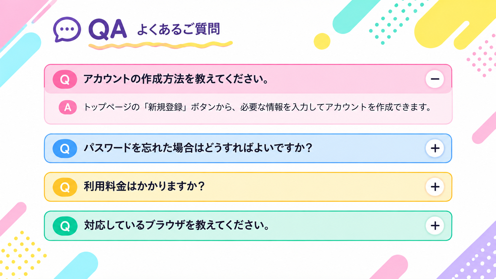
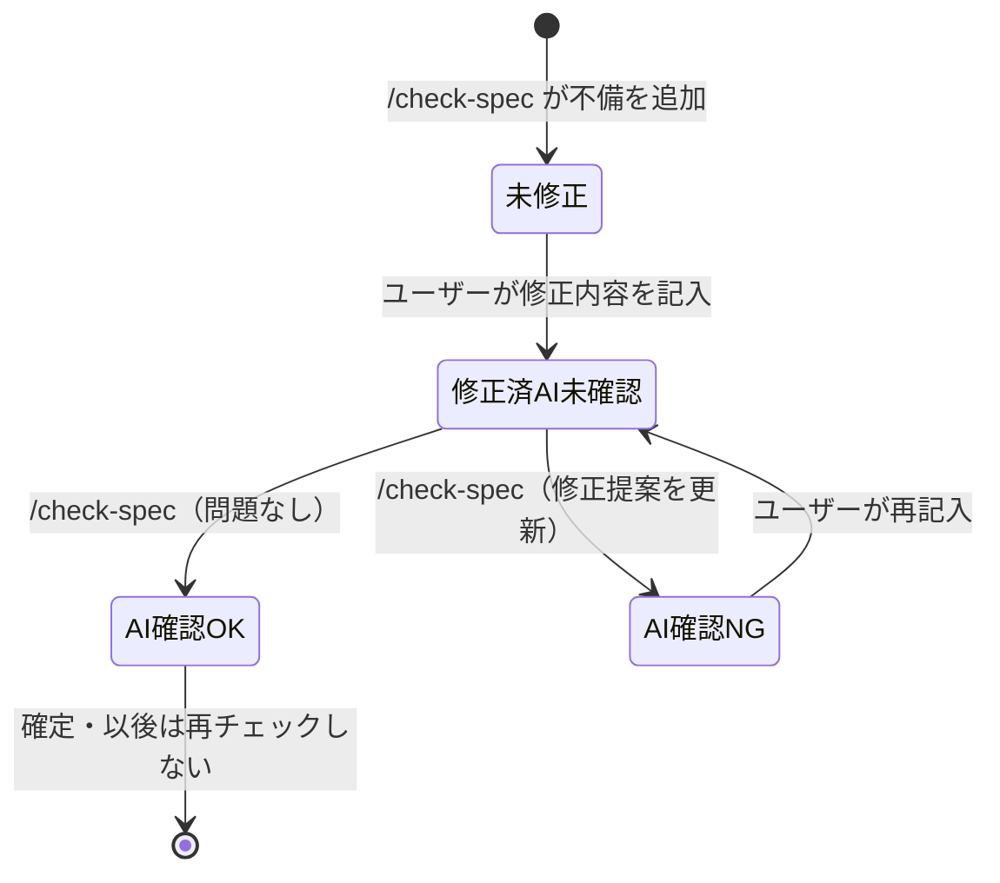
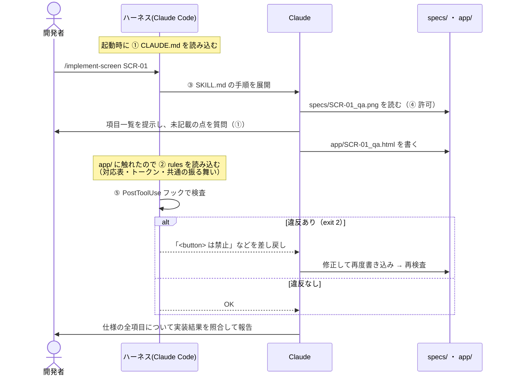

# 仕様駆動開発サンプル：ハーネス設定はどう適用されるか

画面仕様書（画像）とハーネス設定（`.claude/`）を用意し、Claude Code に Web UI を実装させるサンプルです。
**「何を作るか」は仕様書、「どう作るか（見た目・振る舞いの決まりごと）」はハーネス設定** に分けて置き、
ハーネス設定が **いつ・どの強さで** AI に適用されるかを説明します。

## フォルダ構成

```
.
├── specs/                         … 仕様書（何を作るか）
│   └── SCR-01_qa.png
├── .claude/                       … ハーネス設定（どう作るか）
│   ├── CLAUDE.md                  ① 常時適用の指示
│   ├── rules/material-design.md   ② 対象ファイルを扱う時だけ適用されるルール
│   ├── skills/implement-screen/   ③ 呼び出された時だけ適用される手順（画面の実装）
│   ├── skills/check-spec/         ③ 呼び出された時だけ適用される手順（仕様書エラーチェック）
│   ├── settings.json              ④ 権限 ／ ⑤⑥ フックの登録
│   ├── hooks/check-material.mjs   ⑤ ファイル書き込みのたびに必ず実行される検査
│   ├── hooks/protect-specs.mjs    ⑥ ツール実行の直前に必ず実行される仕様書保護
│   ├── hooks/guard-spec-review.mjs ⑦ 確認一覧の「修正内容」列などを AI から保護
│   └── hooks/gate-implementation.mjs ⑧ エラー未解決のまま実装するときに確認ダイアログ
├── spec-reviews/                  … 仕様書確認一覧（ユーザーが確認・修正する）
│   ├── editor.html                … 確認一覧の編集画面（ダブルクリックで開く）
│   ├── _template.md
│   └── SCR-01_qa.md
├── userExec/                      … Claude Code に入力するプロンプト例
└── app/                           … ハーネスを適用して生成する実装（/implement-screen で作成。リポジトリには含めない）
```


## 仕様書



「よくあるご質問」画面です。画像には見た目（ポップな配色）も描かれていますが、
ハーネスを適用すると見た目はハーネス設定（Material Design 3）が優先されます。

## ハーネス設定の層

| # | ファイル | いつ適用されるか | 強制力 | このサンプルでの役割 |
|---|---|---|---|---|
| ① | `.claude/CLAUDE.md` | セッション開始時に **常に** 読み込まれる | 指示（AI の判断に依存） | 仕様駆動の原則、曖昧な点は質問、`app/` に出力 |
| ② | `.claude/rules/material-design.md` | `paths` に一致するファイル（`app/**`）を **扱う時だけ** 読み込まれる | 指示（AI の判断に依存） | 種別→コンポーネント対応表、デザイントークン、共通の振る舞い |
| ③ | `.claude/skills/implement-screen/` | `/implement-screen SCR-01` と **呼ばれた時**（または説明文に合う依頼の時） | 手順（AI の判断に依存） | 不備確認→項目一覧→部品決定→実装→照合 |
| ③ | `.claude/skills/check-spec/` | `/check-spec [SCR-01]` と **呼ばれた時**、および実装の手順2から | 手順（AI の判断に依存） | 仕様書の不備を C01〜C10 で判定して `spec-reviews/` に記録し、ユーザーの修正内容を AI確認OK／NG にする（仕様書は直さない） |
| ④ | `settings.json` の `permissions` | ツール実行のたびにハーネスが判定 | **強制**（AI は迂回できない） | `Edit` / `Write` による `specs/` の書き換えを禁止 |
| ⑤ | `settings.json` の `hooks` ＋ `check-material.mjs` | `Write` / `Edit` の直後に **必ず** 実行 | **強制**（違反時は AI に差し戻し） | `<button>` 等のネイティブ要素・色の直書きを検出 |
| ⑥ | `settings.json` の `hooks` ＋ `protect-specs.mjs` | ファイル編集・シェル実行の **直前** に必ず実行 | **強制**（実行そのものを止める） | ④ では防げない `rm` / `sed -i` / `Remove-Item` / `git checkout` 等による `specs/` の変更もブロック |
| ⑦ | `settings.json` の `hooks` ＋ `guard-spec-review.mjs` | `spec-reviews/` の編集・シェル実行の **直前** に必ず実行 | **強制**（実行そのものを止める） | 「修正内容」列の書き換え、確定行の変更、`修正済AI未確認` への変更、行削除をブロック |
| ⑧ | `settings.json` の `hooks` ＋ `gate-implementation.mjs` | `app/` への書き込みの **直前** に必ず実行 | **強制**（ユーザーの承認が必要） | 重大度エラーが全件 AI確認OK でなければ「エラーの項目が修正されていません。本当に修正しますか？」を表示 |

ポイントは2つです。

- **読み込みのタイミングが違う**：①は常に、②は該当ファイルの時だけ、③は呼ばれた時だけ。必要な時に必要な指示だけがコンテキストに入ります。
- **強制力が違う**：①〜③は「AI へのお願い」で、読み落としや解釈違いが起こり得ます。④〜⑧はハーネス（プログラム）が実行するので必ず効きます。大事なルールは指示（②③）と検査（⑤〜⑧）の両方に書きます。

## 仕様書不備の確認と修正（spec-reviews/）

仕様書（PNG）は AI もユーザーも直接は直さず、不備への回答は `spec-reviews/<仕様書名>.md` の
「修正内容」列に書きます。AI確認OK になった修正内容は **仕様書の付属情報** として、仕様書と同じ扱いで実装に使われます。

列：`No | 重大度 | チェックID | 箇所 | 不備の内容 | 実装時の扱い | 修正提案 | 修正状態 | 修正内容`

**編集画面：** `spec-reviews/editor.html` をダブルクリックし、確認一覧の md を「ファイルを開く」かドラッグ＆ドロップで開きます。
修正状態（コンボボックス）と修正内容（テキスト）だけを編集し、「保存（ダウンロード）」で作り直した md をダウンロードして、`spec-reviews` の同名ファイルに上書きします。

- 選べる修正状態は「未修正」「修正済AI未確認」だけです。修正内容を入力すると、自動で「修正済AI未確認」になります。
- AI確認OK の行は編集できません。AI確認NG の行は、【NG】付きの修正提案を見て入力し直します。
- 作り直した md で変わるのは、編集した行の2列だけです。
- `/check-spec` で AI が一覧を更新した後は、md を開き直してから編集してください（古い内容で上書きすると AI の更新が消えます）。



| 誰が | できること | 守る仕組み |
|---|---|---|
| ユーザー | 「修正内容」の記入、修正状態を `修正済AI未確認` にする（エディタで直接編集） | ― |
| AI | 不備の行の追加、`修正済AI未確認` → `AI確認OK`／`AI確認NG`、修正提案の更新、集計の更新 | ⑦ がそれ以外の変更をブロック |
| AI | 仕様書（`specs/`）の変更 | ④⑥ が常にブロック |
| AI | 重大度エラーが残ったままの実装 | ⑧ がユーザーに確認 |

## 適用の流れ

`/implement-screen SCR-01` を実行した場合：



仕様書を変えずに `.claude/rules/material-design.md` のシードカラーや対応表を書き換えれば、見た目がまとめて変わります。

## 試してみる

前提：Claude Code と Node.js（フック実行用）。

1. このフォルダで `claude` を起動し、`/memory` で ① が読み込まれていることを確認する。
2. `/implement-screen SCR-01` を実行する。生成された `app/SCR-01_qa.html` をブラウザで開く。
3. **⑤ フックを体験する**：「開閉ボタンを普通の `<button>` で、背景色 `#ff0000` にして」と依頼する。
   Claude がそのとおり書き込むと、直後にフックが違反を返して差し戻されます。
   （② を読んだ Claude が最初から断ることもあります。これは指示の層が効いた例です）
4. **④⑥ 仕様書保護を体験する**：「`specs/` の画像を修正して」「`specs/` の画像を削除して」と依頼すると、ハーネスが拒否します。
5. **仕様書エラーチェック**：`/check-spec`（または「仕様書の不備をチェックして」）を実行すると、
   `spec-reviews/SCR-01_qa.md` に不備一覧が記録されます。
   「修正内容」を記入して修正状態を `修正済AI未確認` にし、もう一度 `/check-spec` を実行すると AI確認OK／NG が付きます。
   エラーが残ったまま `/implement-screen SCR-01` を実行すると、書き込み前に確認ダイアログが出ます。
